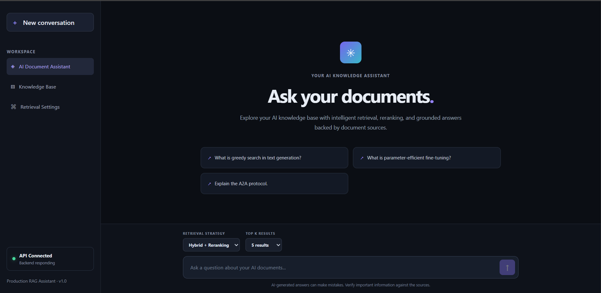
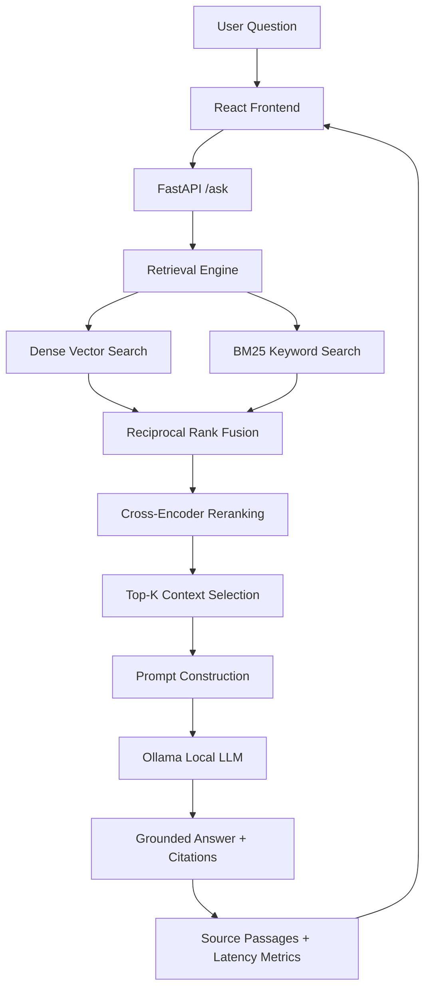

# RAGOps-Engine
### Local-First Retrieval-Augmented Generation with Hybrid Search, Cross-Encoder Reranking & Quantitative Evaluation


**RAGOps-Engine** is an end-to-end, local-first Retrieval-Augmented Generation (RAG) system designed to answer questions over technical documentation with grounded responses and numbered source citations.

The system implements four retrieval strategies — dense vector search, BM25 keyword search, hybrid retrieval using Reciprocal Rank Fusion (RRF), and hybrid retrieval with cross-encoder reranking.

Unlike basic RAG implementations, RAGOps-Engine includes a quantitative evaluation framework to measure and compare retrieval performance using Recall@K and Mean Reciprocal Rank (MRR).

The complete pipeline runs locally using **Ollama**, without requiring hosted LLM APIs or API keys.

---

## Table of Contents

- [Project Overview](#project-overview)
- [Screenshots](#screenshots)
- [Key Features](#key-features)
- [System Architecture](#system-architecture)
- [Retrieval Pipeline](#retrieval-pipeline)
- [Technology Stack](#technology-stack)
- [Document Corpus & Ingestion](#document-corpus--ingestion)
- [Getting Started](#getting-started)
- [Docker Deployment](#docker-deployment)
- [API Documentation](#api-documentation)
- [Evaluation Framework](#evaluation-framework)
- [Benchmark Results](#benchmark-results)
- [Project Structure](#project-structure)
- [Testing & Continuous Integration](#testing--continuous-integration)
- [Engineering Decisions](#engineering-decisions)
- [Limitations](#limitations)
- [Roadmap](#roadmap)
- [Acknowledgements](#acknowledgements)
- [License](#license)

---

## Project Overview

Retrieval-Augmented Generation systems can produce unreliable answers when retrieval quality is poor or generated responses are not sufficiently grounded in source material.

RAGOps-Engine addresses this problem by combining multiple retrieval techniques, ranking optimization, controlled generation, and measurable evaluation.

### Design Goals

1. **Retrieval Quality:** Compare semantic, lexical, and hybrid retrieval approaches.
2. **Ranking Optimization:** Improve candidate relevance through Reciprocal Rank Fusion and cross-encoder reranking.
3. **Grounded Generation:** Generate responses using retrieved document passages with numbered citations.
4. **Local-First Architecture:** Run inference locally using Ollama.
5. **Measurable Performance:** Evaluate retrieval strategies using a fixed golden dataset.
6. **Engineering Reliability:** Include automated tests, containerization, and GitHub Actions CI.

---

## Screenshots

### 1. Application Interface

The React-based interface allows users to interact with the RAG system and configure retrieval strategies.



### 2. Generated Answers with Source Citations

Answers are generated from retrieved context and accompanied by numbered citations and supporting source passages.


### 3. Retrieval Evaluation Dashboard

Evaluation results provide a quantitative comparison of the retrieval strategies using Recall@5 and MRR.


### 4. Retrieval Strategy Comparison

Comparison of the different retrieval approaches, including the impact of cross-encoder reranking.


---

## Key Features

### Retrieval & Ranking

- Four selectable retrieval modes:
  - Vector Search
  - BM25
  - Hybrid Search
  - Hybrid Search + Reranking
- Dense semantic retrieval using sentence embeddings.
- Keyword retrieval using BM25Okapi.
- Reciprocal Rank Fusion for combining independent rankings.
- Cross-encoder reranking for improved relevance.

### Grounded Generation

- Local LLM inference through Ollama.
- Context-constrained answer generation.
- Numbered source citations such as `[1]` and `[2]`.
- Instructions to respond with "I don't know" when the retrieved context does not support an answer.
- Retrieved source passages returned alongside generated answers.

### Evaluation & Observability

- Recall@K evaluation.
- Mean Reciprocal Rank (MRR).
- Easy and hard evaluation tiers.
- Configurable retrieval modes and Top-K.
- Optional LLM-as-a-Judge faithfulness evaluation.
- Separate retrieval and generation latency measurements.
- Optional minimum Recall@K evaluation threshold.

### Application & Engineering

- FastAPI backend.
- React 19 and Vite frontend.
- Interactive retrieval-mode selector.
- Adjustable Top-K.
- Expandable source passages.
- API status indicator.
- Persistent ChromaDB storage.
- Docker and Docker Compose support.
- Pytest unit tests.
- GitHub Actions CI pipeline.

---

## System Architecture



### Core Components

| Component | Responsibility |
|---|---|
| FastAPI | Handles API requests and responses |
| ChromaDB | Persistent vector storage and similarity search |
| BGE Embeddings | Converts document chunks and queries into embeddings |
| BM25 | Performs keyword-based retrieval |
| RRF | Combines rankings from multiple retrievers |
| Cross-Encoder | Rescores retrieved candidates |
| Ollama | Runs the local generation model |
| React | Provides the interactive user interface |
| Evaluation Harness | Measures retrieval performance |

---

## Retrieval Pipeline

The default retrieval strategy is `hybrid_rerank`.

### Step 1: Dense Vector Retrieval

Documents are converted into embeddings using:

`BAAI/bge-small-en-v1.5`

Query embeddings are compared against the indexed document chunks using ChromaDB similarity search.

This enables semantic retrieval beyond exact keyword matching.

### Step 2: BM25 Keyword Retrieval

BM25Okapi retrieves documents based on lexical relevance.

This complements semantic search by identifying important keywords and technical terminology.

### Step 3: Reciprocal Rank Fusion

The two independent rankings are combined using Reciprocal Rank Fusion.

The RRF score is calculated as:

\[
RRF(d)=\sum_{r \in R}\frac{1}{k_0+rank_r(d)}
\]

Where:

- \(d\) represents a document.
- \(R\) represents the set of retrieval rankings.
- \(rank_r(d)\) is the document's rank in retriever \(r\).
- \(k_0\) is the RRF smoothing constant.

### Step 4: Cross-Encoder Reranking

The fused candidate pool is rescored using:

`cross-encoder/ms-marco-MiniLM-L-6-v2`

Unlike bi-encoder retrieval, the cross-encoder evaluates query-passage relevance jointly.

This helps improve the ordering of retrieved candidates.

### Step 5: Context Selection

The highest-ranked passages are selected using the configurable Top-K parameter.

Default configuration:

| Parameter | Value |
|---|---:|
| Dense retrieval candidates | 20 |
| BM25 retrieval candidates | 20 |
| Final Top-K | 5 |

### Step 6: Grounded Answer Generation

The selected passages are supplied to the local LLM through a structured prompt.

The model is instructed to:

- Answer using the provided context.
- Include numbered source citations.
- Avoid unsupported claims.
- Respond with "I don't know" when the context does not contain the answer.

The API returns the generated answer, source passages, and latency information.

---

## Technology Stack

| Layer | Technology |
|---|---|
| Programming Language | Python 3.11 |
| Backend Framework | FastAPI |
| ASGI Server | Uvicorn |
| Vector Database | ChromaDB |
| Embedding Model | BAAI/bge-small-en-v1.5 |
| Keyword Retrieval | rank-bm25 |
| Rank Fusion | Reciprocal Rank Fusion |
| Reranking Model | cross-encoder/ms-marco-MiniLM-L-6-v2 |
| Local LLM Runtime | Ollama |
| Generation Model | Llama 3.2 3B |
| Frontend | React 19 |
| Frontend Build Tool | Vite |
| Testing | Pytest |
| Containerization | Docker |
| CI/CD | GitHub Actions |

---

## Document Corpus & Ingestion

The system uses a technical documentation corpus containing 29 documents from openly licensed documentation sources.

| Source | Documents |
|---|---:|
| Hugging Face Transformers | 18 |
| Hugging Face PEFT | 4 |
| A2A Protocol | 7 |
| **Total** | **29** |

### Document Processing

The ingestion pipeline:

1. Downloads documentation using `scripts/build_corpus.py`.
2. Removes front matter.
3. Removes images and code blocks.
4. Flattens document links.
5. Splits documents into overlapping word-based chunks.
6. Generates embeddings.
7. Persists vectors in ChromaDB.

### Chunking Configuration

| Parameter | Default |
|---|---:|
| Total Documents | 29 |
| Total Chunks | 260 |
| Chunk Size | 180 words |
| Chunk Overlap | 40 words |

Chunking parameters are configurable through:

- `CHUNK_WORDS`
- `CHUNK_OVERLAP`

**Corpus scope:** The current implementation removes code blocks during preprocessing. Consequently, questions requiring exact source-code syntax are outside the supported corpus scope.

---

## Getting Started

### Prerequisites

- Python 3.11
- Ollama installed and running
- Node.js 22+ (frontend)
- Git
- Docker (optional)

### 1. Clone the Repository

```bash
git clone https://github.com/<your-username>/RAGOps-Engine.git

cd RAGOps-Engine
```

### 2. Create a Python Virtual Environment

**Windows PowerShell:**

```powershell
python -m venv .venv

.venv\Scripts\Activate.ps1
```

**Linux / macOS:**

```bash
python -m venv .venv

source .venv/bin/activate
```

Install dependencies:

```bash
pip install -r requirements.txt
```

### 3. Configure Environment Variables

Copy the example environment file.

**Windows PowerShell:**

```powershell
Copy-Item .env.example .env
```

**Linux / macOS:**

```bash
cp .env.example .env
```

Configuration:

| Variable | Default | Purpose |
|---|---|---|
| `OLLAMA_URL` | `http://localhost:11434` | Ollama endpoint |
| `LLM_MODEL` | `llama3.2:3b` | Generation model |
| `EMBED_MODEL` | `BAAI/bge-small-en-v1.5` | Embedding model |
| `RERANK_MODEL` | `cross-encoder/ms-marco-MiniLM-L-6-v2` | Reranking model |
| `CHUNK_WORDS` | `180` | Chunk size |
| `CHUNK_OVERLAP` | `40` | Chunk overlap |

### 4. Download the LLM

```bash
ollama pull llama3.2:3b
```

Ensure Ollama is running before launching the application.

### 5. Build the Document Index

The cleaned documents are already available in `data/raw/`.

Run:

```bash
python -m app.ingest
```

This builds the persistent ChromaDB index.

To refresh or extend the corpus:

```bash
python scripts/build_corpus.py

python -m app.ingest
```

Update the `SOURCES` configuration in `scripts/build_corpus.py` before rebuilding if you want to add documentation sources.

### 6. Start the Backend

```bash
uvicorn app.main:app --reload
```

Backend URL:

`http://127.0.0.1:8000`

Interactive Swagger documentation:

`http://127.0.0.1:8000/docs`

Health endpoint:

`http://127.0.0.1:8000/health`

**Note:** The first request may take longer because embedding and reranking models are loaded lazily.

### 7. Start the Frontend

Open another terminal:

```bash
cd frontend

npm ci

npm run dev
```

The Vite development server proxies `/api/*` requests to the backend.

Start the backend before launching the frontend.

---

## Docker Deployment

Build and start the application:

```bash
docker compose up --build
```

The Docker configuration expects Ollama to run on the host and be accessible through:

`host.docker.internal:11434`

Build the document index before starting the containers:

```bash
python -m app.ingest
```

The Docker configuration mounts `./data` for persistent index storage.

Embedding and reranking models are downloaded on first use.

---

## API Documentation

### Health Check

**Endpoint:** `GET /health`

Example response:

```json
{
  "status": "ok"
}
```

### Ask a Question

**Endpoint:** `POST /ask`

#### Request Parameters

| Parameter | Type | Default | Description |
|---|---|---|---|
| `question` | string | Required | User question, minimum 3 characters |
| `mode` | string | `hybrid_rerank` | Retrieval strategy |
| `k` | integer | `5` | Number of context passages (1–10) |

Supported retrieval modes:

- `vector`
- `bm25`
- `hybrid`
- `hybrid_rerank`

#### Example Request

```bash
curl -X POST http://127.0.0.1:8000/ask \
  -H "Content-Type: application/json" \
  -d '{
    "question": "How does a client agent discover what a remote agent can do?",
    "mode": "hybrid_rerank",
    "k": 5
  }'
```

#### Example Response

```json
{
  "answer": "A client agent can discover remote agent capabilities through the A2A discovery mechanism [1].",
  "sources": [
    {
      "source": "A2A Protocol: Agent Discovery in A2A",
      "chunk_id": "a2a_agent_discovery-3",
      "text": "First 300 characters of the retrieved passage..."
    }
  ],
  "latency_ms": {
    "retrieval": 120,
    "generation": 4300
  }
}
```

The response includes:

- Generated answer.
- Numbered source citations.
- Retrieved source metadata and passage previews.
- Retrieval latency.
- Generation latency.

#### Error Responses

| Status Code | Description |
|---|---|
| 400 | Invalid retrieval mode or request |
| 503 | Ollama backend unavailable |

---

## Evaluation Framework

RAGOps-Engine includes a dedicated evaluation harness for comparing retrieval strategies against a fixed golden dataset.

The goal is to measure retrieval performance independently of subjective answer quality.

### Evaluation Dataset

The dataset is located at:

`eval/golden.jsonl`

It contains 41 questions:

| Difficulty | Questions |
|---|---:|
| Easy | 29 |
| Hard | 12 |
| **Total** | **41** |

A retrieval counts as a hit when the expected source document appears within the top-K retrieved results.

### Evaluation Metrics

**1. Recall@K**

Measures whether the expected source document is retrieved within the top-K results.

\[
Recall@K=\frac{\text{Queries with relevant document in top K}}{\text{Total queries}}
\]

**2. Mean Reciprocal Rank (MRR)**

Measures how highly the first relevant document appears in the ranking.

\[
MRR=\frac{1}{N}\sum_{i=1}^{N}\frac{1}{rank_i}
\]

Where \(rank_i\) is the rank of the first relevant document for query \(i\).

### Running Evaluations

Run all retrieval strategies:

```bash
python -m eval.run_eval
```

Run with a Recall@5 threshold:

```bash
python -m eval.run_eval --k 5 --min-recall 0.9
```

The evaluation exits with status code 1 if the `hybrid_rerank` Recall@5 score falls below the configured threshold.

Run optional LLM-as-a-Judge evaluation:

```bash
python -m eval.run_eval --judge 10
```

The faithfulness check requires Ollama to be running.

Results are written to:

`eval/results.json`

---

## Benchmark Results

The following results were obtained using the current 41-question golden dataset.

### Overall Performance

**Recall@5 and MRR — All 41 Questions**

| Retrieval Strategy | Recall@5 | MRR |
|---|---:|---:|
| Vector Search | 0.951 | 0.850 |
| BM25 | 0.902 | 0.764 |
| Hybrid | 0.951 | 0.837 |
| **Hybrid + Reranking** | **1.000** | **0.888** |

### Hard Query Performance

**Recall@5 and MRR — 12 Hard Questions**

| Retrieval Strategy | Recall@5 | MRR |
|---|---:|---:|
| Vector Search | 0.917 | 0.694 |
| BM25 | 0.750 | 0.569 |
| Hybrid | 0.833 | 0.632 |
| **Hybrid + Reranking** | **1.000** | **0.757** |

### Key Observations

**1. Reranking provides the strongest retrieval performance.**

Hybrid retrieval followed by cross-encoder reranking achieves 1.000 Recall@5 across the complete evaluation dataset.

**2. Reranking improves difficult-query retrieval.**

The reranked strategy achieves 1.000 Recall@5 on the hard tier, outperforming the other evaluated strategies.

**3. Hybrid retrieval alone does not guarantee improvement.**

Plain hybrid retrieval does not outperform vector search on the hard tier. Combining retrievers is not automatically better without effective ranking.

**4. Quantitative evaluation makes retrieval decisions measurable.**

Using a fixed golden dataset allows different retrieval approaches to be compared consistently.

### Benchmark Caveats

These results should be interpreted within the scope of the experiment:

- The corpus contains only 29 documents.
- The evaluation dataset contains 41 questions.
- The hard tier contains only 12 questions.
- Matching is document-level rather than passage-level.
- The optional LLM-judge faithfulness results are not included in the committed benchmark results.

These metrics demonstrate comparative retrieval performance on this specific corpus. They are not a general accuracy guarantee.

---

## Project Structure

```text
RAGOps-Engine/
│
├── app/
│   ├── main.py              # FastAPI application and endpoints
│   ├── retrieval.py         # Retrieval strategies and reranking
│   ├── fusion.py            # Reciprocal Rank Fusion
│   ├── chunking.py          # Text chunking and overlap
│   ├── ingest.py            # Document ingestion and indexing
│   ├── llm.py               # Prompt construction and Ollama client
│   └── config.py            # Environment configuration
│
├── data/
│   ├── raw/                 # Cleaned documentation corpus
│   └── index/               # Persistent ChromaDB index
│
├── eval/
│   ├── golden.jsonl         # Evaluation question dataset
│   ├── run_eval.py          # Evaluation runner
│   └── results.json         # Evaluation results
│
├── frontend/                # React 19 + Vite application
│
├── scripts/
│   └── build_corpus.py      # Corpus download and cleaning
│
├── tests/
│   └── test_units.py        # Chunking and RRF unit tests
│
├── docs/
│   ├── Home.png
│   ├── Result.png
│   ├── Result_2.png
│   ├── Evaluation.png
│   └── Retrieval_Strategy.png
│
├── .github/
│   └── workflows/
│       └── ci.yml           # GitHub Actions workflow
│
├── Dockerfile
├── docker-compose.yml
├── requirements.txt
├── .env.example
└── README.md
```

---

## Testing & Continuous Integration

### Running Tests

Execute the unit test suite:

```bash
python -m pytest -q tests
```

### GitHub Actions

The GitHub Actions workflow runs on pushes and pull requests to `main`.

The CI pipeline includes:

- Python unit tests.
- Frontend production build.
- Docker image build.

This provides automated validation of the core application components and build configuration.

---

## Engineering Decisions

| Decision | Reasoning |
|---|---|
| Local LLM through Ollama | Avoid hosted inference dependencies and API keys |
| Dense + BM25 retrieval | Combine semantic understanding with lexical matching |
| Reciprocal Rank Fusion | Merge independent retrieval rankings |
| Cross-encoder reranking | Improve relevance ordering of retrieved candidates |
| ChromaDB persistence | Maintain a reusable local vector index |
| Golden evaluation dataset | Compare retrieval strategies consistently |
| Recall@K and MRR | Measure retrieval coverage and ranking quality |
| FastAPI | Provide a structured API interface |
| React + Vite | Provide an interactive user experience |
| Docker | Simplify environment setup and application packaging |
| GitHub Actions | Automate testing and build validation |

---

## Limitations

Current implementation limitations:

- Small, single-domain documentation corpus.
- Limited evaluation dataset.
- Document-level rather than passage-level evaluation.
- A 3B-parameter local model may occasionally miss citations or produce unsupported statements.
- Code blocks are removed during preprocessing.
- No authentication or rate limiting.
- No streaming responses.
- Primarily designed for local deployment and technical demonstration.

---

## Roadmap

- [ ] Introduce passage-level retrieval evaluation.
- [ ] Expand the golden dataset.
- [ ] Add unanswerable questions to evaluate retrieval and generation behavior.
- [ ] Integrate the Recall@K threshold into CI.
- [ ] Add API integration tests using mocked retriever and LLM components.
- [ ] Implement streaming responses.
- [ ] Introduce heading-aware chunking.
- [ ] Prepend document titles and section headings to retrieved passages.
- [ ] Expand the documentation corpus across additional technical domains.

---

## Acknowledgements

The documentation corpus is built from openly licensed documentation sourced from:

- Hugging Face Transformers
- Hugging Face PEFT
- A2A (Agent2Agent) Protocol

---

## License

A license file has not yet been added.

MIT and Apache-2.0 are common choices for open-source projects. Add a `LICENSE` file before declaring the repository's license.

---

**Built as an independent AI engineering project focused on retrieval quality, grounded generation, local inference, and measurable evaluation.**