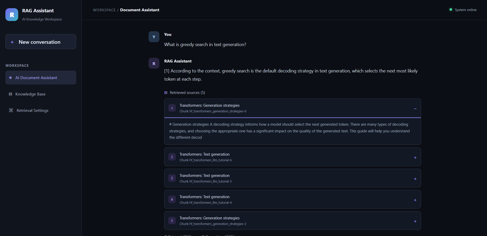
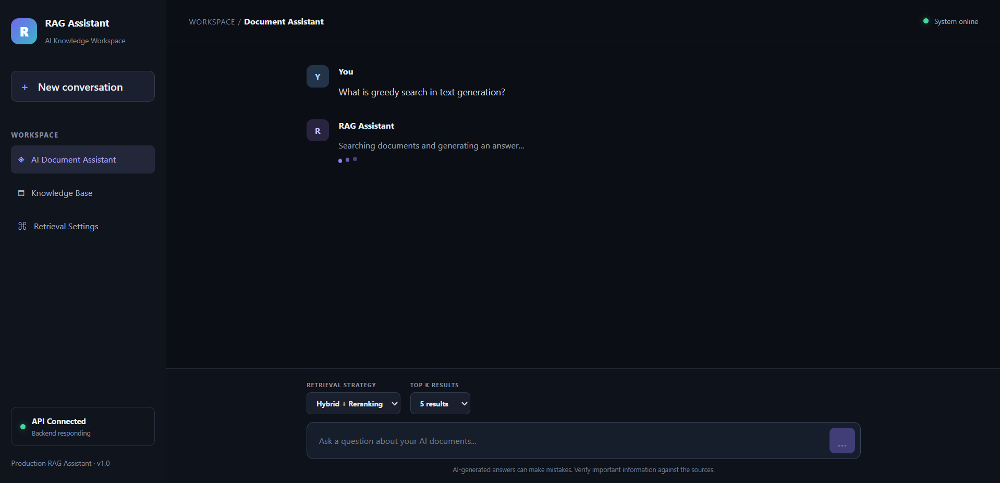
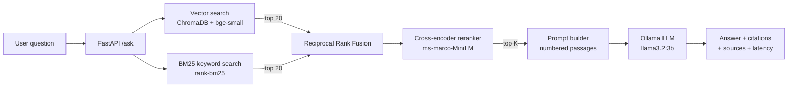

# RAGOps-Engine


\


A **local-first Retrieval-Augmented Generation (RAG) system** that answers questions over a technical document corpus and cites its sources. It combines dense vector search, BM25 keyword search, Reciprocal Rank Fusion (RRF), and cross-encoder reranking, then generates grounded answers with a locally hosted LLM through [Ollama](https://ollama.com).

The project also includes an **evaluation harness** (Recall\@K, MRR, chunk-level metrics, and bootstrap confidence intervals) and a **CI quality gate**, allowing retrieval strategies to be compared using measurable results.

> No hosted LLM API or API key is required. Everything runs locally on your machine.

## Screenshots

### Application Interface


### Generated Answer with Sources



### Evaluation Results


### Evaluation Results


---

## Table of Contents

- [Features](#features)
- [Architecture](#architecture)
- [Tech Stack](#tech-stack)
- [Corpus](#corpus)
- [Getting Started](#getting-started)
- [Docker](#docker)
- [API Reference](#api-reference)
- [Evaluation](#evaluation)
- [Testing and CI](#testing-and-ci)
- [Project Structure](#project-structure)
- [Configuration](#configuration)
- [Troubleshooting](#troubleshooting)
- [Limitations](#limitations)
- [Roadmap](#roadmap)
- [Acknowledgements](#acknowledgements)
- [License](#license)

---

## Features

- **Four retrieval modes:** `vector`, `bm25`, `hybrid`, and `hybrid_rerank`.
- **Reciprocal Rank Fusion:** Combines dense and keyword rankings without requiring score normalization.
- **Cross-encoder reranking:** Rescores the fused candidate pool to improve retrieval precision.
- **Grounded answers:** The model is instructed to use only the numbered context passages, cite them as `[1]`, `[2]`, and respond with *"I don't know based on the provided documents."* when the answer is unavailable.
- **Per-request latency breakdown:** Separates retrieval latency from generation latency.
- **Evaluation harness:** Includes document-level and chunk-level metrics, 95% bootstrap confidence intervals, an optional recall gate for CI, and an optional LLM faithfulness check.
- **React chat interface:** Includes a retrieval-mode selector, adjustable top-K, expandable source passages, latency display, and API status indicator.
- **Engineering practices:** Pytest unit tests, Docker support, and a four-job GitHub Actions pipeline.

## Architecture



In the default `hybrid_rerank` mode, the vector and BM25 retrievers each return candidates, RRF fuses their rankings, and the cross-encoder rescores the fused candidate pool. The top K passages (default 5) are then included in the generation prompt.

The other modes skip some of these stages:

| Mode            | Pipeline                                                |
| --------------- | ------------------------------------------------------- |
| `vector`        | Dense embedding search only                             |
| `bm25`          | BM25 keyword search only                                |
| `hybrid`        | Vector + BM25 fused with RRF                            |
| `hybrid_rerank` | Hybrid candidates reranked by a cross-encoder (default) |

### How the Pieces Work

- **Chunking** (`app/chunking.py`): Word-window chunks of 180 words with a 40-word overlap. Trailing fragments under 20 words are dropped because the overlap already covers them.
- **Embeddings:** `BAAI/bge-small-en-v1.5` with normalized vectors and cosine similarity. Queries are prefixed with the BGE retrieval instruction; documents are not.
- **Index:** ChromaDB persisted in `data/index/`, plus `chunks.json`, which feeds BM25 and chunk lookup.
- **Lazy loading:** The retriever is created on the first `/ask` call and the reranker on the first reranked call. Consequently, the first request may be slower.
- **Generation** (`app/llm.py`): Uses the Ollama `/api/chat` endpoint with temperature `0.1` and non-streaming responses.

## Tech Stack

| Layer          | Technology                                       |
| -------------- | ------------------------------------------------ |
| API            | FastAPI, Uvicorn                                 |
| Vector store   | ChromaDB (persistent, cosine)                    |
| Embeddings     | `BAAI/bge-small-en-v1.5` (sentence-transformers) |
| Keyword search | `rank-bm25` (BM25Okapi)                          |
| Reranker       | `cross-encoder/ms-marco-MiniLM-L-6-v2`           |
| LLM            | `llama3.2:3b` via Ollama                         |
| Frontend       | React 19, Vite                                   |
| Tooling        | Pytest, Docker, GitHub Actions, oxlint           |

## Corpus

The corpus contains **29 documents** from openly licensed documentation, fetched and cleaned by `scripts/build_corpus.py`.

| Source                          | Documents |
| ------------------------------- | --------: |
| Hugging Face Transformers docs  |        18 |
| Hugging Face PEFT docs          |         4 |
| A2A (Agent2Agent) protocol docs |         7 |
| **Total**                       |    **29** |

Cleaning removes front matter, HTML comments, images, code blocks, and documentation-framework tags, and flattens links. The resulting corpus is split into approximately **260 chunks**.

The cleaned corpus is committed in `data/raw/`, so the index can be rebuilt locally without fetching the documents again.

Each file in `data/raw/` follows one convention: **the first line is the document title, and the rest is the body.** Titles become the `source` shown in citations and used by the evaluator.

> Code blocks are stripped to keep the corpus prose-only, so questions about exact code syntax are outside the current scope.

## Getting Started

### Prerequisites

- Python 3.11
- [Ollama](https://ollama.com/download) installed and running
- Node.js 22+ (only required for the frontend)
- Approximately 2 GB of free disk space for models and the index

### 1. Clone and Install

```bash
git clone https://github.com/IamKD64/RAGOps-Engine.git
cd RAGOps-Engine

python -m venv .venv
pip install -r requirements.txt
```

Activate the virtual environment:

**Windows PowerShell**

```powershell
.\.venv\Scripts\Activate.ps1
```

**Linux / macOS**

```bash
source .venv/bin/activate
```

### 2. Configure

Create your local environment file:

**Windows PowerShell**

```powershell
Copy-Item .env.example .env
```

**Linux / macOS**

```bash
cp .env.example .env
```

The defaults work out of the box. See [Configuration](#configuration) for the available variables.

### 3. Pull the LLM

```bash
ollama pull llama3.2:3b
```

Make sure Ollama is running before starting the API.

### 4. Build the Index

```bash
python -m app.ingest
```

This command:

1. Chunks every document in `data/raw/`.
2. Generates embeddings for the chunks.
3. Writes the ChromaDB collection.
4. Saves `data/index/chunks.json`.

The embedding model downloads automatically on first use.

To refresh or extend the corpus, edit `SOURCES` in `scripts/build_corpus.py` (raw GitHub Markdown URLs can be used), run:

```bash
python scripts/build_corpus.py
python -m app.ingest
```

### 5. Run the API

```bash
uvicorn app.main:app --reload
```

The API will be available at:

- API: [http://127.0.0.1:8000](http://127.0.0.1:8000)
- Interactive API documentation: [http://127.0.0.1:8000/docs](http://127.0.0.1:8000/docs)

### 6. Run the Frontend (Optional)

Open another terminal:

```bash
cd frontend
npm ci
npm run dev
```

Open the URL printed by Vite, usually:

[http://localhost:5173](http://localhost:5173)

Vite proxies `/api/*` requests to `http://127.0.0.1:8000`, so **start the API before the frontend**.

The proxy exists only in the Vite development server. A production build of the frontend is not served by the API.

### Quick Smoke Test

Check the API health:

```bash
curl http://127.0.0.1:8000/health
```

Send a question:

```bash
curl -X POST http://127.0.0.1:8000/ask \
  -H "Content-Type: application/json" \
  -d '{"question": "What is greedy search in text generation?"}'
```

## Docker

Start the API container:

```bash
docker compose up --build
```

The Compose configuration:

- Runs the API on port 8000.
- Mounts `./data` into the container.
- Points `OLLAMA_URL` at `http://host.docker.internal:11434`.

**Ollama must be running on the host machine.**

Docker runs the backend only. Run the frontend separately using the commands in [Step 6](#6-run-the-frontend-optional).

Build the index first (Step 4) so `data/index/` exists. Alternatively, run ingestion inside the container:

```bash
docker compose run --rm api python -m app.ingest
```

Embedding and reranker models download on first use. They are not cached between container rebuilds unless a volume is configured for the Hugging Face cache.

## API Reference

### `GET /health`

Example response:

```json
{
  "status": "ok"
}
```

This confirms that the server is running. It does not verify the index or the Ollama connection.

### `POST /ask`

| Field      | Type    | Default         | Notes                                          |
| ---------- | ------- | --------------- | ---------------------------------------------- |
| `question` | string  | Required        | Minimum 3 characters                           |
| `mode`     | string  | `hybrid_rerank` | `vector`, `bm25`, `hybrid`, or `hybrid_rerank` |
| `k`        | integer | `5`             | 1 to 10 passages                               |

Example request:

```bash
curl -X POST http://127.0.0.1:8000/ask \
  -H "Content-Type: application/json" \
  -d '{"question": "How does a client agent discover what a remote agent can do?", "mode": "hybrid_rerank", "k": 5}'
```

Example response:

```json
{
  "answer": "...grounded answer with citations like [1] and [2]...",
  "sources": [
    {
      "source": "A2A Protocol: Agent Discovery in A2A",
      "chunk_id": "a2a_agent_discovery-3",
      "text": "first 300 characters of the passage..."
    }
  ],
  "latency_ms": {
    "retrieval": 120,
    "generation": 4300
  }
}
```

| Status | Meaning                                                   |
| ------ | --------------------------------------------------------- |
| `400`  | Invalid retrieval mode                                    |
| `422`  | Validation error (question too short or `k` out of range) |
| `503`  | Ollama backend unavailable                                |

## Evaluation

Run the evaluation harness from the project root:

```bash
python -m eval.run_eval
```

Useful options:

```bash
# Compare all retrieval modes and tiers
python -m eval.run_eval

# Apply a minimum Recall@5 quality gate
python -m eval.run_eval --k 5 --min-recall 0.95

# Use more bootstrap samples
python -m eval.run_eval --bootstrap-samples 5000

# Run the optional LLM faithfulness check (requires Ollama)
python -m eval.run_eval --judge 10
```

Results are written to `eval/results.json`.

### Golden Set

`eval/golden.jsonl` contains **41 questions**:

- 29 easy questions
- 12 hard questions

Each record includes a question, expected source, difficulty tier, and relevant chunk IDs.

Example:

```json
{
  "q": "...",
  "source": "A2A Protocol: Agent Discovery in A2A",
  "tier": "easy",
  "relevant_chunk_ids": [
    "a2a_agent_discovery-0",
    "a2a_agent_discovery-1"
  ]
}
```

### Two Levels of Measurement

| Level        | A hit means                                                          | Metrics                                      |
| ------------ | -------------------------------------------------------------------- | -------------------------------------------- |
| **Document** | The expected source document appears in the top K                    | Recall\@K, MRR                               |
| **Chunk**    | At least one hand-labelled answer-bearing chunk appears in the top K | Hit recall\@K, chunk coverage recall\@K, MRR |

All 41 questions have chunk labels. The evaluation results include 95% bootstrap confidence intervals for the reported metrics.

### Results (K = 5)

**Document level — all 41 questions**

| Mode              | Recall\@5 |          95% CI |       MRR |
| ----------------- | --------: | --------------: | --------: |
| vector            |     0.951 |     0.878–1.000 |     0.850 |
| bm25              |     0.902 |     0.805–0.976 |     0.764 |
| hybrid            |     0.951 |     0.878–1.000 |     0.837 |
| **hybrid_rerank** | **1.000** | **1.000–1.000** | **0.888** |

**Document level — hard tier (12 questions)**

| Mode              | Recall\@5 |       MRR |
| ----------------- | --------: | --------: |
| vector            |     0.917 |     0.694 |
| bm25              |     0.750 |     0.569 |
| hybrid            |     0.833 |     0.632 |
| **hybrid_rerank** | **1.000** | **0.757** |

**Chunk level — all 41 questions**

| Mode              | Hit recall\@5 | Coverage recall\@5 |       MRR |
| ----------------- | ------------: | -----------------: | --------: |
| vector            |         0.854 |              0.772 |     0.801 |
| bm25              |         0.927 |              0.738 |     0.738 |
| hybrid            |         0.878 |              0.808 |     0.813 |
| **hybrid_rerank** |     **0.976** |          **0.846** | **0.829** |

**Chunk level — hard tier (12 questions)**

| Mode              | Hit recall\@5 | Coverage recall\@5 |       MRR |
| ----------------- | ------------: | -----------------: | --------: |
| vector            |         0.583 |              0.472 |     0.583 |
| bm25              |         0.750 |              0.625 |     0.507 |
| hybrid            |         0.667 |              0.583 |     0.528 |
| **hybrid_rerank** |     **1.000** |          **0.819** | **0.649** |

### How to Read These Numbers

- **Reranking gives the clearest gain**, especially on the hard tier at chunk level, where it lifts hit recall from 0.583 (vector) to 1.000.
- **Plain hybrid does not reliably beat the best single retriever.** On hard questions it trails vector at document level and BM25 at chunk level, so fusion alone is not a guaranteed improvement.
- On easy questions at chunk level, `hybrid_rerank` (0.966 hit recall) does not beat BM25 (1.000), so reranking is not a universal improvement either.
- **Confidence intervals matter.** With only 12 hard questions, intervals are wide. For example, hard-tier BM25 document recall spans 0.50–1.00. The `1.000–1.000` interval for `hybrid_rerank` reflects zero misses in this sample, not certainty.
- The corpus is small (29 documents), and the golden set is small. Treat these numbers as a comparison between strategies on this corpus, not as a general accuracy claim.
- Chunk labels are tied to chunk IDs such as `a2a_agent_discovery-3`. If `CHUNK_WORDS`, `CHUNK_OVERLAP`, or the corpus changes, chunk IDs may shift and the chunk-level labels must be regenerated.
- The optional `--judge` faithfulness check uses the same Ollama model that generates the answer. It is a preliminary self-judge, not an independent evaluation, and it is not included in the committed results.

## Testing and CI

Run the unit tests:

```bash
python -m pytest -q tests
```

Unit tests cover:

- Chunking size and overlap
- Empty input
- Invalid overlap
- Reciprocal Rank Fusion

These tests do not require model downloads and run in seconds.

### GitHub Actions

GitHub Actions (`.github/workflows/ci.yml`) runs four jobs on pushes and pull requests to `main`.

| Job                                  | What it does                                                                                                                                |
| ------------------------------------ | ------------------------------------------------------------------------------------------------------------------------------------------- |
| **Python Unit Tests**                | Installs pytest and runs `tests/`                                                                                                           |
| **React Production Build**           | Runs `npm ci` and `npm run build` in `frontend/` using Node 22                                                                              |
| **Docker Image Build**               | Builds the API Docker image                                                                                                                 |
| **RAG Retrieval Quality Evaluation** | Installs dependencies, rebuilds the index, runs `python -m eval.run_eval --min-recall 0.95`, and uploads `eval/results.json` as an artifact |

The evaluation job fails the build if `hybrid_rerank` document-level Recall\@5 drops below **0.95**. This helps guard against retrieval regressions caused by changes to chunking, embeddings, or fusion.

The evaluation job has a 45-minute timeout and caches Hugging Face model files to reduce repeated downloads.

## Project Structure

```text
RAGOps-Engine/
├── app/
│   ├── main.py          # FastAPI app (/health, /ask)
│   ├── retrieval.py     # Vector, BM25, hybrid, reranking
│   ├── fusion.py        # Reciprocal Rank Fusion
│   ├── chunking.py      # Word-window chunking with overlap
│   ├── ingest.py        # Builds ChromaDB index + chunks.json
│   ├── llm.py           # Prompt construction + Ollama client
│   └── config.py        # Environment-driven settings
├── data/
│   ├── raw/             # Cleaned source documents (29)
│   └── index/           # Generated index (gitignored)
├── eval/
│   ├── golden.jsonl     # 41 labelled questions
│   ├── run_eval.py      # Retrieval metrics, bootstrap CIs, optional judge
│   └── results.json    # Latest evaluation results
├── frontend/            # React + Vite chat UI
│   ├── src/App.jsx
│   └── vite.config.js   # Development proxy: /api -> API
├── scripts/
│   └── build_corpus.py  # Downloads and cleans documents
├── tests/
│   └── test_units.py    # Chunking and RRF unit tests
├── .github/workflows/ci.yml
├── Dockerfile
├── docker-compose.yml
├── requirements.txt
└── .env.example
```

## Configuration

Set these variables in `.env` (copied from `.env.example`) or as environment variables.

| Variable        | Default                                | Purpose                |
| --------------- | -------------------------------------- | ---------------------- |
| `OLLAMA_URL`    | `http://localhost:11434`               | Ollama server          |
| `LLM_MODEL`     | `llama3.2:3b`                          | Generation model       |
| `EMBED_MODEL`   | `BAAI/bge-small-en-v1.5`               | Embedding model        |
| `RERANK_MODEL`  | `cross-encoder/ms-marco-MiniLM-L-6-v2` | Cross-encoder          |
| `CHUNK_WORDS`   | `180`                                  | Words per chunk        |
| `CHUNK_OVERLAP` | `40`                                   | Overlap between chunks |

> `CHUNK_WORDS` and `CHUNK_OVERLAP` are read by `app/config.py` but are not listed in `.env.example`. Add them to `.env` if you want to tune them. Re-run `python -m app.ingest` after changing the embedding model or chunk settings.

## Troubleshooting

| Symptom                                                       | Likely cause and fix                                                                                                                                  |
| ------------------------------------------------------------- | ----------------------------------------------------------------------------------------------------------------------------------------------------- |
| `503 LLM backend unavailable`                                 | Ollama is not running or the model is not pulled. Start Ollama and run `ollama pull llama3.2:3b`. In Docker, confirm `host.docker.internal` resolves. |
| `FileNotFoundError: chunks.json` or missing collection `docs` | The index has not been built. Run `python -m app.ingest`.                                                                                             |
| `No files in data/raw`                                        | The corpus is missing. Run `python scripts/build_corpus.py`.                                                                                          |
| Frontend shows **API Offline**                                | The API is not running on port 8000, or you opened a built `dist/` directory instead of the Vite development server.                                  |
| First request is very slow                                    | Models load lazily on first use. Subsequent requests should be faster.                                                                                |
| Answers ignore citations or over-answer                       | The 3B model is small. Try a larger `LLM_MODEL` or lower `k`.                                                                                         |
| Chunk-level evaluation numbers look wrong after a change      | Chunk IDs may have changed. Regenerate `relevant_chunk_ids` in `eval/golden.jsonl`.                                                                   |

## Limitations

- Small, single-domain corpus with only 29 documents.
- Small evaluation set with 41 questions, including only 12 hard questions.
- Document-level metrics can be satisfied by any chunk from the expected document. Chunk-level metrics are stricter but depend on stable chunk IDs.
- A 3B-parameter local model can miss citations or over-answer. Answer quality depends heavily on the model used.
- Answer quality is not scored by the committed evaluation; the committed evaluation measures retrieval.
- The golden set contains no unanswerable questions, so the system's "I don't know" behaviour is untested.
- Code blocks are removed from the corpus.
- No authentication, rate limiting, CORS configuration, or streaming. The application is intended for local use and demos, not direct internet exposure.
- The retriever and models are loaded in-process, so each Uvicorn worker holds its own copy.

## Roadmap

- [x] Chunk-level evaluation with bootstrap confidence intervals
- [x] Run the recall gate in CI
- [x] Larger golden set, including unanswerable questions
- [x] Independent judge model for faithfulness scoring
- [x] API tests with a mocked retriever and LLM
- [ ] Streaming responses
- [ ] Heading-aware chunking with document titles prepended
- [ ] Serve the built frontend from the API container
- [ ] Health check that verifies the index and Ollama connection

## Acknowledgements

Documentation corpus from the [Hugging Face Transformers](https://github.com/huggingface/transformers), [PEFT](https://github.com/huggingface/peft), and [A2A](https://github.com/a2aproject/A2A) repositories (Apache-2.0 licensed).

Built with FastAPI, ChromaDB, sentence-transformers, rank-bm25, Ollama, React, and Vite.

## License

No license file is included yet. Add a `LICENSE` file (MIT or Apache-2.0 are common choices) and update this section before publishing.
