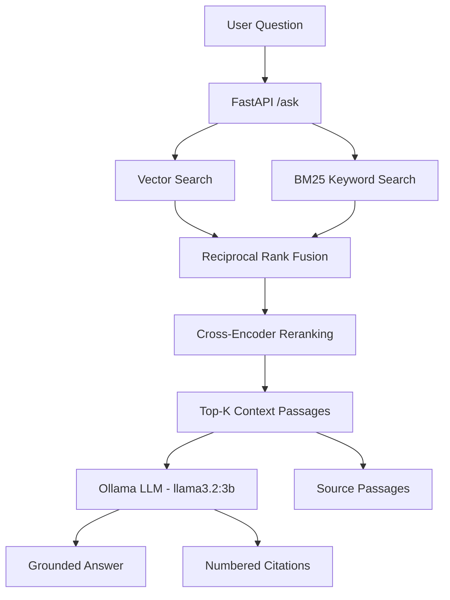

# RAGOps-Engine

A local-first **Retrieval-Augmented Generation (RAG)** system that answers questions over a technical document corpus with numbered source citations.

It combines hybrid retrieval (dense vectors + BM25 fused with Reciprocal Rank Fusion), cross-encoder reranking, and a locally hosted LLM via Ollama. It also includes an evaluation harness to compare retrieval strategies using measurable performance metrics.

**No hosted LLM API or API key is required.**

<!-- Add a screenshot or GIF of the UI here -->
<!--  -->

---

## Features

- **Four retrieval modes:** `vector`, `bm25`, `hybrid`, and `hybrid_rerank`.
- **Reciprocal Rank Fusion (RRF):** Combines dense vector and keyword search rankings.
- **Cross-encoder reranking:** Rescores the fused candidate pool for improved relevance.
- **Grounded answers:** Answers are generated only from retrieved context passages.
- **Numbered source citations:** Answers cite supporting passages using `[1]`, `[2]`, etc.
- **Hallucination control:** Responds with "I don't know" when the retrieved context does not contain the answer.
- **Latency breakdown:** Measures retrieval and generation time separately.
- **Evaluation harness:** Recall@K and MRR metrics across retrieval modes and difficulty tiers.
- **Optional LLM-as-a-Judge:** Evaluates answer faithfulness.
- **React chat UI:** Retrieval-mode selector, adjustable top-K, expandable source passages, and API status indicator.
- **Docker support:** Containerized deployment.
- **Automated CI:** Pytest, frontend build, and Docker build through GitHub Actions.

---

## Architecture



In `hybrid_rerank` mode (the default):

1. Vector search retrieves 20 candidates.
2. BM25 retrieves 20 candidates.
3. RRF fuses both rankings.
4. A cross-encoder reranks the fused candidate pool.
5. The top K passages (default: 5) are passed to the LLM.
6. The LLM generates a grounded answer with numbered citations.

---

## Tech Stack

| Layer | Technology |
|---|---|
| API | FastAPI, Uvicorn |
| Vector Store | ChromaDB (persistent, cosine similarity) |
| Embeddings | BAAI/bge-small-en-v1.5 |
| Keyword Search | rank-bm25 (BM25Okapi) |
| Reranker | cross-encoder/ms-marco-MiniLM-L-6-v2 |
| LLM | llama3.2:3b via Ollama |
| Frontend | React 19, Vite |
| Testing | Pytest |
| Containerization | Docker |
| CI/CD | GitHub Actions |

---

## Corpus

The project currently contains **29 documents** from openly licensed technical documentation.

| Source | Documents |
|---|---:|
| Hugging Face Transformers documentation | 18 |
| Hugging Face PEFT documentation | 4 |
| A2A (Agent2Agent) protocol documentation | 7 |
| **Total** | **29** |

### Document Processing

Documents are fetched and cleaned using:

```bash
python scripts/build_corpus.py
```

The preprocessing pipeline:

- Removes front matter.
- Removes images and code blocks.
- Flattens links.
- Splits documents into word-based chunks.

| Parameter | Default |
|---|---:|
| Chunk size | 180 words |
| Chunk overlap | 40 words |
| Total chunks | 260 |

Chunk size and overlap are configurable through `CHUNK_WORDS` and `CHUNK_OVERLAP`.

**Note:** Code blocks are removed to keep the corpus prose-only. Questions about exact code syntax are therefore outside the current scope.

---

## Getting Started

### Prerequisites

- Python 3.11
- Ollama installed and running
- Node.js 22+ (frontend only)
- Git

### 1. Clone the Repository

```bash
git clone https://github.com/<your-username>/RAGOps-Engine.git

cd RAGOps-Engine
```

### 2. Create a Virtual Environment

```bash
python -m venv .venv
```

Activate it:

**Windows PowerShell:**

```powershell
.venv\Scripts\Activate.ps1
```

**Linux / macOS:**

```bash
source .venv/bin/activate
```

Install dependencies:

```bash
pip install -r requirements.txt
```

### 3. Configure Environment Variables

Copy the example environment file:

**Windows PowerShell:**

```powershell
Copy-Item .env.example .env
```

**Linux / macOS:**

```bash
cp .env.example .env
```

Configure the following variables:

| Variable | Default | Purpose |
|---|---|---|
| `OLLAMA_URL` | `http://localhost:11434` | Ollama server URL |
| `LLM_MODEL` | `llama3.2:3b` | Generation model |
| `EMBED_MODEL` | `BAAI/bge-small-en-v1.5` | Embedding model |
| `RERANK_MODEL` | `cross-encoder/ms-marco-MiniLM-L-6-v2` | Cross-encoder model |
| `CHUNK_WORDS` | `180` | Words per chunk |
| `CHUNK_OVERLAP` | `40` | Overlap between chunks |

### 4. Pull the LLM

```bash
ollama pull llama3.2:3b
```

Make sure Ollama is running before starting the API.

### 5. Build the Vector Index

The cleaned corpus is already available in `data/raw/`.

Run:

```bash
python -m app.ingest
```

To refresh or extend the corpus:

1. Edit the `SOURCES` configuration in `scripts/build_corpus.py`.
2. Run `python scripts/build_corpus.py`.
3. Run `python -m app.ingest` again.

### 6. Start the API

```bash
uvicorn app.main:app --reload
```

API endpoint:

```text
http://127.0.0.1:8000
```

Interactive API documentation:

```text
http://127.0.0.1:8000/docs
```

**Note:** The first request may take longer because the embedding model and reranker are loaded lazily.

### 7. Run the Frontend (Optional)

Open another terminal:

```bash
cd frontend

npm ci

npm run dev
```

Vite proxies `/api/*` requests to `http://127.0.0.1:8000`.

Make sure the API is running before starting the frontend.

---

## Docker Deployment

Build and start the application:

```bash
docker compose up --build
```

**Docker notes:**

- Ollama is expected to run on the host machine.
- The container connects to Ollama through `host.docker.internal:11434`.
- The `./data` directory is mounted for persistent index storage.
- Build the index before starting Docker.
- Embedding and reranker models are downloaded on first use.

---

## API Reference

### Health Check

**Endpoint:**

```http
GET /health
```

Example response:

```json
{
  "status": "ok"
}
```

### Ask a Question

**Endpoint:**

```http
POST /ask
```

| Field | Type | Default | Description |
|---|---|---|---|
| `question` | string | Required | Question (minimum 3 characters) |
| `mode` | string | `hybrid_rerank` | Retrieval strategy |
| `k` | integer | `5` | Number of context passages (1–10) |

Supported retrieval modes:

- `vector`
- `bm25`
- `hybrid`
- `hybrid_rerank`

### Example Request

```bash
curl -X POST http://127.0.0.1:8000/ask \
  -H "Content-Type: application/json" \
  -d '{
    "question": "How does a client agent discover what a remote agent can do?",
    "mode": "hybrid_rerank",
    "k": 5
  }'
```

### Example Response

```json
{
  "answer": "A client agent can discover remote agent capabilities through the A2A discovery mechanism [1].",
  "sources": [
    {
      "source": "A2A Protocol: Agent Discovery in A2A",
      "chunk_id": "a2a_agent_discovery-3",
      "text": "First 300 characters of the retrieved passage..."
    }
  ],
  "latency_ms": {
    "retrieval": 120,
    "generation": 4300
  }
}
```

### Error Responses

| Status Code | Description |
|---|---|
| 400 | Invalid retrieval mode or request |
| 503 | Ollama backend is unreachable |

---

## Evaluation

The project includes an evaluation harness to compare retrieval strategies using a predefined golden dataset.

### Run Evaluation

Compare all retrieval modes:

```bash
python -m eval.run_eval
```

Run evaluation with a Recall@K threshold:

```bash
python -m eval.run_eval --k 5 --min-recall 0.9
```

Run the optional LLM faithfulness judge:

```bash
python -m eval.run_eval --judge 10
```

The LLM judge requires Ollama to be running.

### Evaluation Dataset

The golden dataset (`eval/golden.jsonl`) contains:

- 41 evaluation questions.
- 29 easy questions.
- 12 hard questions.

A retrieval counts as a hit when the expected source document appears within the top K retrieved results.

Evaluation results are saved to:

```text
eval/results.json
```

### Overall Results

Recall@5 and MRR across all 41 questions:

| Retrieval Mode | Recall@5 | MRR |
|---|---:|---:|
| Vector | 0.951 | 0.850 |
| BM25 | 0.902 | 0.764 |
| Hybrid | 0.951 | 0.837 |
| **Hybrid + Reranking** | **1.000** | **0.888** |

### Hard-Tier Results

Results across the 12 hard questions:

| Retrieval Mode | Recall@5 | MRR |
|---|---:|---:|
| Vector | 0.917 | 0.694 |
| BM25 | 0.750 | 0.569 |
| Hybrid | 0.833 | 0.632 |
| **Hybrid + Reranking** | **1.000** | **0.757** |

### Performance Analysis

- **Reranking provides the clearest improvement**, especially for difficult queries.
- Plain hybrid retrieval does not outperform vector retrieval on the hard tier, demonstrating that fusion alone does not guarantee better retrieval.
- Hybrid reranking achieves 1.000 Recall@5 across this evaluation dataset.
- The corpus contains only 29 documents, and evaluation matching is performed at the document level rather than the passage level.
- The hard evaluation tier contains only 12 questions.

**Important:** These results represent a comparison of retrieval strategies on this specific corpus and evaluation dataset. They should not be interpreted as general-purpose accuracy claims.

The optional LLM-as-a-Judge faithfulness evaluation is not included in the committed results.

---

## Project Structure

```text
RAGOps-Engine/
│
├── app/
│   ├── main.py          # FastAPI application (/health, /ask)
│   ├── retrieval.py     # Vector, BM25, hybrid and reranking
│   ├── fusion.py        # Reciprocal Rank Fusion
│   ├── chunking.py      # Word-window chunking with overlap
│   ├── ingest.py        # ChromaDB index and chunk generation
│   ├── llm.py           # Prompt construction and Ollama client
│   └── config.py        # Environment-driven configuration
│
├── data/
│   ├── raw/             # Cleaned source documents (29)
│   └── index/           # Generated vector index (gitignored)
│
├── eval/
│   ├── golden.jsonl     # Evaluation questions
│   ├── run_eval.py      # Recall@K, MRR and faithfulness judge
│   └── results.json     # Latest evaluation results
│
├── frontend/            # React + Vite chat interface
│
├── scripts/
│   └── build_corpus.py  # Downloads and cleans documentation
│
├── tests/
│   └── test_units.py    # Chunking and RRF unit tests
│
├── .github/
│   └── workflows/
│       └── ci.yml      # GitHub Actions CI workflow
│
├── Dockerfile
├── docker-compose.yml
├── requirements.txt
└── README.md
```

---

## Testing and CI/CD

Run unit tests locally:

```bash
python -m pytest -q tests
```

### GitHub Actions

GitHub Actions automatically runs the following checks on every push and pull request to `main`:

- Unit tests using Pytest.
- Production frontend build.
- Docker image build.

This helps ensure that application components remain functional as the project evolves.

---

## Limitations

- Small, single-domain document corpus.
- Evaluation dataset is relatively small and uses document-level matching.
- A 3B-parameter local LLM may occasionally miss citations or generate unsupported answers.
- Answer quality depends heavily on the selected language model.
- Code blocks are removed during document preprocessing.
- No authentication, rate limiting, or streaming support currently.
- Primarily intended for local deployment, experimentation, and demonstrations.

---

## Roadmap

- [ ] Passage-level retrieval evaluation.
- [ ] Expand the golden evaluation dataset.
- [ ] Add unanswerable questions to the evaluation dataset.
- [ ] Integrate the Recall@K threshold gate into CI.
- [ ] Add API tests using mocked retriever and LLM components.
- [ ] Implement streaming responses.
- [ ] Introduce heading-aware chunking.
- [ ] Prepend document titles and metadata to chunks.

---

## Acknowledgements

The documentation corpus is built from the following openly licensed repositories:

- Hugging Face Transformers
- Hugging Face PEFT
- A2A (Agent2Agent) Protocol

Thanks to the maintainers and contributors of these projects for making their documentation available.

---

## License

Add a `LICENSE` file to the repository and specify the license here.

Common choices include:

- MIT License
- Apache License 2.0

